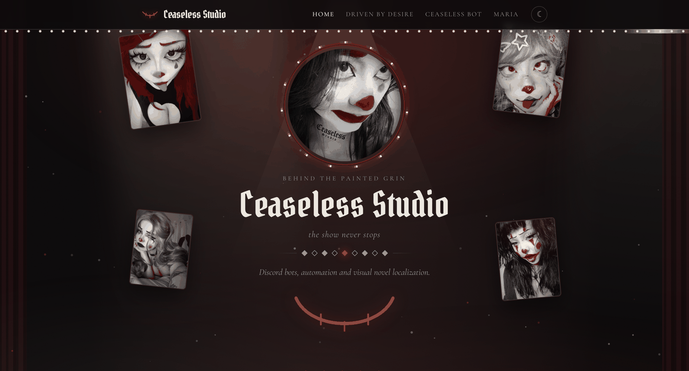
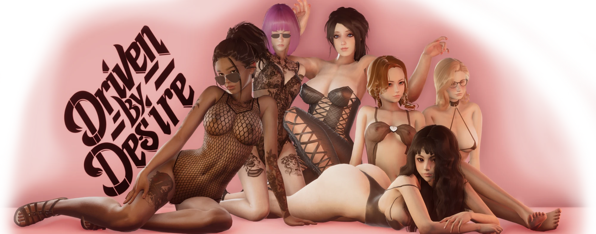



  

# Ceaseless Studio

**Behind the painted grin.** Discord bots, automation and visual novel localization. The show never stops.

🌐 **Live site:** https://ceaseless-studio.github.io/

## What's here

The source of the Ceaseless Studio website: a static page set served by GitHub Pages, with no build step.

| Page | What it is |
|---|---|
| `index.html` | Home: live hero (medallion, stage light, name), who's behind the mask, the main project, torn backstage notes, other acts, tools and languages, the club flyer |
| `ceaseless-bot.html` | **Ceaseless Bot** - the backstage of a modeling agency: contracts, reaction roles, early builds, reports and publishing |
| `maria.html` | **Maria** - Cease's personal assistant: cards, greetings, proof approvals and publishing |
| `driven-by-desire.html` | **Driven By Desire** - the visual novel: story, cast cards, art, an 18+ after-hours gallery, build stats and links |
| `style.css` | Shared styles and the scene: grain, glow, spotlights, curtain folds, marquee bulbs |
| `trace-cards.css` | The playing-card trail: card face, rank, suit and the fade-out animation |
| `backstage-note.css` | The torn notes on the home page: paper, tape, blood stains and the handwritten lines, with texts drawn at random from a pool of twenty-six |
| `night.css` | Night mode: darker palette, deeper shadows, vignette and the toggle in the menu |
| `ticket.css` | The ADMIT ONE ticket that slides in once per visit and flies away when clicked |
| `applause.css` | The APPLAUSE sign in the footer: bulbs chase and a "bravo" shows up when you click it |
| `flyer.css` | The club flyer at the bottom of the home page: dark torn paper, neon crimson title, the track lyric and the stuck chorus |
| `site.js` | Scene effects: reveal, read progress, medallion parallax and tilt, cursor light, card tilt, dust, opening curtain, EN/RU switch, playing-card cursor trail, backstage note lines, night mode, first-visit ticket, footer applause sign |
| `assets/` | Banner, key art, tier icons, Driven By Desire art |

## Main project: Driven By Desire

  

The heart of the studio. Ceaseless Studio keeps order on the visual novel's Discord server, where both bots work: Ceaseless Bot (contracts, supporter roles, reports) and Maria (Cease's personal assistant). Supporters rise through five tiers: Newcomer, Wanderer, Rising Star, Seducer, Master of Desire.

## Other acts

- **The Last Embrace** - Russian proofreading for the visual novel by NoX Productions.

## Tools of the trade

Python, discord.py, JavaScript, discord.js, Git.

## Style

Gothic clown: black and white with a crimson accent `#992D22`. Fonts: Pirata One and Cormorant Garamond.

## Motion

The page is a stage, not a screenshot. The home hero is built from live layers instead of one image: a portrait medallion with a ring of chasing bulbs, a spotlight cone from above, the studio name, the tagline and a diamond row, all sitting in the same light as the rest of the scene. Behind it: film grain, breathing crimson light, two sweeping spotlights, drifting haze, velvet folds at the edges, marquee bulbs running under the menu and above the footer, and dust in the beam. Section headings wipe in once as they appear, command rows catch a light sweep on hover, cards tilt, the read-progress line follows the scroll, the painted grin draws itself, and a curtain parts on the first visit per session. The headline glitch runs on the home page only.

Everything moves on `transform`/`opacity` only, without libraries. All of it turns off under `prefers-reduced-motion: reduce`, and the heavy layers (folds, beams, haze, cursor light, dust, curtain) are hidden on screens narrower than 720 px.

The backstage notes reshuffle on every load: fourteen texts come out of a pool of twenty-six and land in the side gutters, two under the mask section and twelve scattered down the page. The scattered notes are laid out by their measured height, so two sheets on the same side never overlap, and the layout is recalculated when images load, on resize and after every text swap. On wide screens (1600 px and up) one of the scattered notes swaps its text every few seconds, so the paper keeps moving; narrower screens keep only the two notes under the mask.

At the very bottom of the home page there is a club flyer: a torn black poster with a crimson neon title, the first verse of the track and a chorus that scrolls like a stuck print. It flickers softly and sits still under reduced motion.

One more trick: the pointer leaves a trail of playing cards. A card drops under the cursor every few steps, each with a random rank and suit, drifts down, turns and fades. It is mouse-only, capped at fourteen live cards, and hidden under reduced motion.

And a quieter one: two torn pages are taped to the stage, stained, scratched and signed. One carries a fingerprint, the other a `no entry` stamp; their lines reveal one after another when the page scrolls to them. From 1600 px up they slide out of the text column into the empty gutters beside the cast, and fall back under it on narrower screens.

## Contact

GitHub: [Ceaseless-Studio](https://github.com/Ceaseless-Studio) · Discord: `ceaselessstudio`

