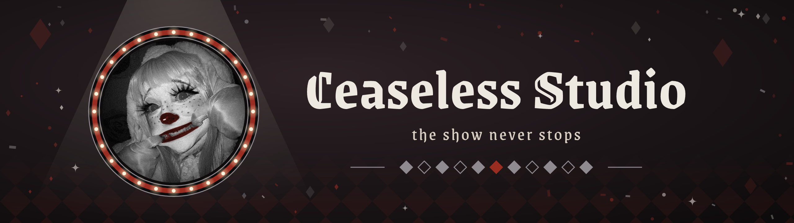
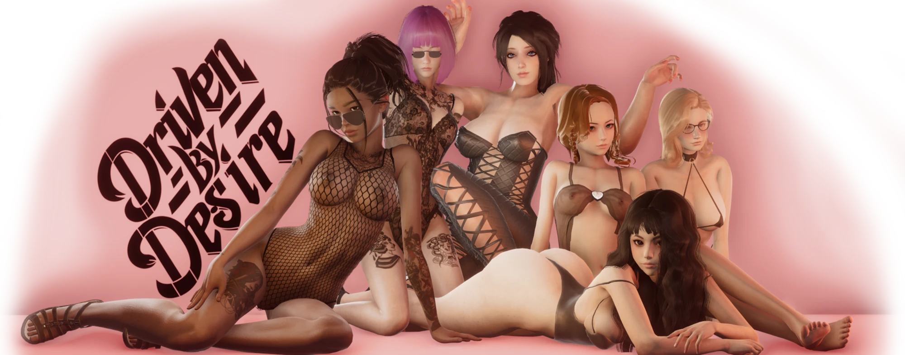

  

# Ceaseless Studio

**Behind the painted grin.** Discord bots, automation and visual novel localization. The show never stops.

🌐 **Live site:** https://ceaselessstudio.github.io/

## What's here

The source of the Ceaseless Studio website: a static page set served by GitHub Pages, with no build step.

| Page | What it is |
|---|---|
| `index.html` | Home: live hero (medallion, stage light, name), who's behind the mask, the main project, other acts, tools and languages |
| `ceaseless-bot.html` | **Ceaseless Bot** - the backstage of a modeling agency: contracts, reaction roles, early builds, reports and publishing |
| `maria.html` | **Maria** - Cease's personal assistant: cards, greetings, proof approvals and publishing |
| `style.css` | Shared styles and the scene: grain, glow, spotlights, curtain folds, marquee bulbs |
| `site.js` | Scene effects: reveal, read progress, medallion parallax and tilt, cursor light, card tilt, dust, opening curtain |
| `assets/` | Banner, key art, tier icons |

## Main project: Driven By Desire

  

The heart of the studio. Ceaseless Studio keeps order on the visual novel's Discord server, where both bots work: Ceaseless Bot (contracts, supporter roles, reports) and Maria (Cease's personal assistant). Supporters rise through five tiers: Newcomer, Wanderer, Rising Star, Seducer, Master of Desire.

## Other acts

- **The Last Embrace** - Russian proofreading for the visual novel by NoX Productions.

## Tools of the trade

Python, discord.py, JavaScript, discord.js, Git.

## Style

Gothic clown: black and white with a crimson accent `#992D22`. Fonts: Pirata One and Cormorant Garamond.

## Motion

The page is a stage, not a screenshot. The home hero is built from live layers instead of one image: a portrait medallion with a ring of chasing bulbs, a spotlight cone from above, the studio name, the tagline and a diamond row, all sitting in the same light as the rest of the scene. Behind it: film grain, breathing crimson light, two sweeping spotlights, drifting haze, velvet folds at the edges, marquee bulbs running under the menu and above the footer, and dust in the beam. Section headings wipe in once as they appear, command rows catch a light sweep on hover, cards tilt, the read-progress line follows the scroll, the painted grin draws itself, and a curtain parts on the first visit per session. The headline glitch runs on the home page only.

Everything moves on `transform`/`opacity` only, without libraries. All of it turns off under `prefers-reduced-motion: reduce`, and the heavy layers (folds, beams, haze, cursor light, dust, curtain) are hidden on screens narrower than 720 px.

## Contact

GitHub: [CeaselessStudio](https://github.com/CeaselessStudio) · Discord: `ceaselessstudio`
